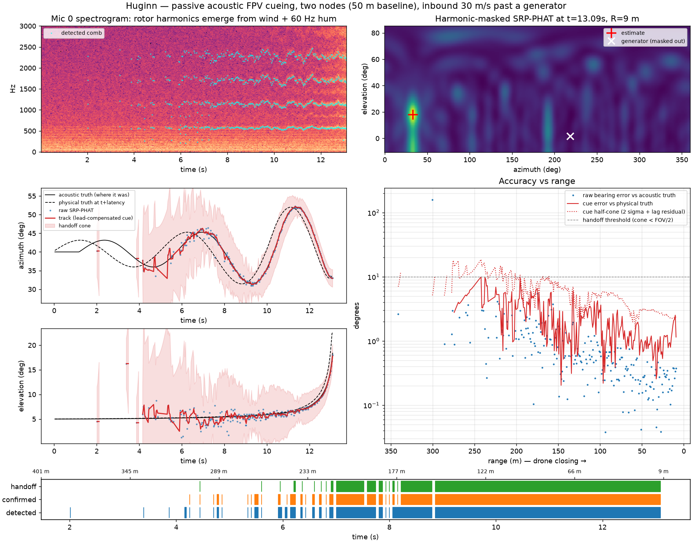
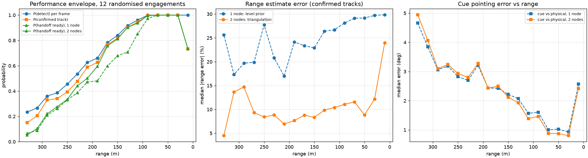
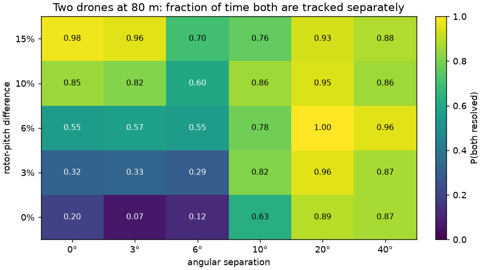
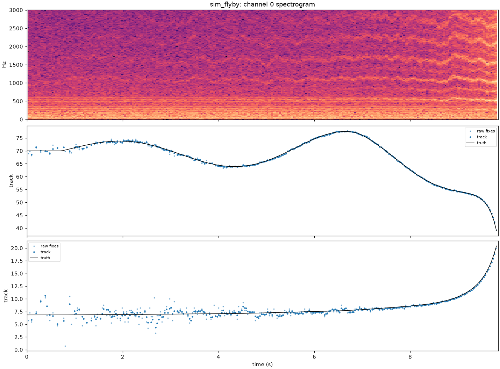

# Huginn: passive acoustic FPV cueing

*Huginn ("thought") was one of Odin's two ravens. It flew out, listened, and reported back.*

Huginn is a small, working model of the first stage of a counter-FPV kill chain. It hears a drone, finds its
direction, holds a track on it, and hands a pointing cue to a fine (visual) tracker. It uses no RF, emits
nothing, and has no line-of-sight requirement until handoff. A second node 50 m away triangulates range, so
the cue can correct for the fact that sound arrives late. **Swarm mode** tracks several drones at once,
separating them by rotor pitch when the array is too small to separate them by angle.

The design follows the shape of the problem 9 Mothers describes publicly: a passive acoustic sensor gives a
coarse track, then hands off to fine tracking, and nodes are networked into a grid. Here, everything upstream
of the camera is built, calibrated against simulated truth, and measured.



## Why this problem

Fiber-optic and autonomous FPVs make RF detection and jamming unreliable, but every multirotor still
*sounds* like a multirotor. It produces a stack of narrow tones at multiples of its rotor shaft rate. The hard
parts are not "run an FFT":

| Problem | What Huginn does about it |
|---|---|
| Wind, ambient noise and generators swamp energy detectors | **Harmonic-comb detector** that scores candidate fundamentals by how many harmonics stand out from a whitened noise floor. 60 Hz-family hum and broadband wind don't form the right comb. |
| Loud nearby clutter pulls a beamformer off target | **Harmonic-masked SRP-PHAT**: only bins attributed to the drone enter the beamformer, so a generator 20 m away doesn't move the peak. |
| You need an honest error bar, not just an angle | Per-fix σ from a Cramér-Rao-style model (`σ ∝ 1/√ΣSNR`), **calibrated against truth** (observed/predicted = 0.97). |
| Spurious fixes and mirror-image outliers | Kalman CV bearing filter with χ² gating, M-of-N confirmation, and bounded coasting. |
| **Sound is late.** The bearing points at where the drone *was* r/c seconds ago, up to ~7° off for a fast crossing target | The cue leads by `r/c + system latency`. Rate is shrunk by its own SNR so a long lead on a noisy track widens the cone instead of pointing confidently wrong. |
| …which needs range, and one array can't measure range | **Two-node triangulation** (`fusion.py`): closest approach of two bearing rays, with σ from crossing geometry plus inter-node emission-time skew. This is fused in log-range with a received-level estimate. The level estimate is always available but biased by how loud each airframe is, so it never averages down; the triangulated estimate does. |
| The camera needs to know *where to look and how wide* | Each `Cue` carries a pointing command, a cone half-angle (2σ + range-uncertainty residual + a 3 g manoeuvre during the lead), and `handoff_ready` when the cone fits inside a 20° acquisition FOV. |

## Results

### Monte Carlo, paired: one node vs two nodes (`scripts/evaluate.py`)

There are 12 randomised engagements. Each varies approach azimuth (from every direction, so some arrive along
the baseline, where triangulation geometry is poor), altitude (15–60 m), speed (20–40 m/s), weave, rotor rate
(220–300 Hz), airframe loudness (86 ± 3 dB at 1 m), ambient noise, wind, and the position of a 50 or 60 Hz
generator. Every engagement is rendered once onto both arrays, then scored twice on **identical audio**: node A
alone, and node A fused with node B (B is 50 m away).

| Metric (median [p10, p90] across runs) | 1 node (level prior) | 2 nodes (triangulation) |
|---|---|---|
| Range estimate error | 30% [13, 53] | **11% [6, 18]** |
| Handoff-ready range | 164 m [95, 282] | **189 m [127, 286]** |
| Cue error vs physical position, median per run | 1.9° [1.3, 2.3] | 1.7° [1.3, 2.5] |
| Cue error vs physical position, p90 per run | 5.7° | 5.6° |
| Handoff containment (drone actually inside the cone when "ready") | 98% [92, 100] | 97% [94, 98] |
| Confirmed track range | 199 m [130, 318] | same |
| Raw bearing error, median per run | 0.40° [0.34, 0.45] | same |
| Gross bearing errors (>5°) | 0.1% [0, 2.1] | same |
| Frames with a valid triangulation fix | — | 90% [79, 95] |
| Real-time factor at p99 compute (demo engagement, with cached steering tables) | 4.8× | 2.6× (both nodes on one CPU) |

**What triangulation bought:** a range estimate that is roughly 3× better, with a far tighter worst case
(p90 of 18% vs 53%). That lets the cone shrink honestly, so handoff happens **25 m earlier in the median and
32 m earlier in the worst decile**, while staying at ≥95% containment. That is roughly 1 extra second of
camera time on a 30 m/s target.

**What it didn't buy:** pointing accuracy is essentially unchanged, about 1.8°. Once range is known to ~30%,
lag correction is no longer the limit; angular-rate noise and drone manoeuvres during the lead are. I only
found this by measuring. The first two-node build *lowered* containment (90% → 82%), because the loose level
prior had been hiding an overconfident tracker. The fix was a physical bound on manoeuvre during the lead
(0.5 · a · lead² / r, at 3 g), applied to both modes. That fix also raised single-node containment from 87%
to 98%.

Clutter-only scenes (3 minutes; 1–3 generators up to 92 dB, wind up to 70 dB): **0 false tracks**. That is a
smoke test, not a false-alarm-rate claim. Fusion cannot create tracks, because range is applied only to
gated hits on A's existing track, so this result holds in both modes.



### Single engagement (`scripts/demo.py`)

An FPV runs in from 400 m at 30 m/s with a 20 m lateral weave, past a running 60 Hz generator. The figure above
shows the two-node cue.

| Metric | 1 node | 2 nodes |
|---|---|---|
| Confirmed track / handoff-ready from | 196 m / 173 m | 196 m / 183 m |
| Raw bearing error vs acoustic truth (median / p90) | 0.54° / 1.9° | same |
| Cue error vs physical position (median / p90) | 2.3° / 6.1° | 2.2° / 5.8° |
| Range estimate error | 29% | 13% |
| Handoff containment | 98% | 96% |

## Swarm mode (`huginn/swarm.py`)

One-way-attack FPVs come in groups, and a 0.5 m array cannot separate them by angle: its beam is tens of degrees
wide. Every airframe has its own rotor rate, though, so separation is **spectral first, spatial second**:

1. **Peel-off comb detection.** Find the strongest harmonic comb, blank its multiples, and search again. Blanking
   is narrow on purpose, because a wide blank erases other drones' upper harmonics. If a candidate comb is
   unusable, it is blanked and the search continues, so a loud drone's leftover rotor lines can't hide a quieter
   drone. (That exact bug hid a drone 44 m away during development.)
2. **One beamformer pass per comb.** Each drone's bins go to SRP-PHAT separately, so each drone gets its own
   bearing even when the drones are inside one beamwidth.
3. **Merge by direction and pitch.** One quad's four rotors drift apart while it manoeuvres and can come back as
   two combs. Pitch is octave-folded, so shaft-rate and blade-pass picks compare equal.
4. **Track-guided beam re-detection.** For each confirmed track that the comb search missed, steer a
   delay-and-sum beam at its predicted direction. That gives up to +9.5 dB of coherent gain with 9 mics. Then
   look for a comb near the track's pitch. A beam also hears loud drones through its sidelobes, so the found comb
   is localised over the **whole sky** and accepted only if it really comes from inside the beam. An earlier
   cone-restricted version let tracks "walk" off along the cone edge; it was caught and removed.
5. **Multi-target tracker.** Global-nearest-neighbour assignment (Hungarian) on bearing (Mahalanobis distance)
   plus a pitch-fingerprint term, with per-track M-of-N confirmation, coasting and duplicate pruning.
6. **Per-drone triangulation.** Node A's fixes are paired with node B's confirmed tracks on pitch and on how
   well the two bearing rays cross.

Scoring is CLEAR-MOT against truth: coverage, false tracks, ID switches and MOTA. It uses the standard
rule of keeping last frame's correspondence while it is still valid. Drones are silenced at impact, so a
"finished" drone can't linger as clutter.

### What one array can resolve

Two drones hovering 80 m out, swept over angular separation and rotor-pitch difference
(`scripts/evaluate_swarm.py`):



- **≥10° apart:** resolved most of the time at any pitch difference. Angle does the work.
- **Same direction (0–3°):** pitch alone separates them, at 82–98% when pitches differ by 10–15%. This is the
  case angle-only processing cannot handle at all.
- **Under 6° and under 6% pitch difference:** not reliably separable (7–57%). With a 1024-point FFT
  (15.6 Hz bins) and four rotors per quad wandering a few percent, these drones are effectively one source to
  one small array. Fixing this needs a second node's geometry or a longer aperture, not more tuning.
- There is a dip around 6° even when pitches differ. The two fixes are close enough to sit on the edge of the
  merge rule, and I'd look there next.

### Raids (two nodes, 4 seeds per size)

FPVs from one 60° threat sector, staggered 250–380 m out, at 20–40 m/s with weave. Rotor rates are random in
200–320 Hz, so close pitches happen. There is also a generator, wind and ambient noise. Medians across seeds:

| Drones | Coverage ≤200 m | Coverage ≤100 m | MOTA | ID switches / drone-min | False-track frames/s | Range err | Containment | All drones ever tracked |
|---|---|---|---|---|---|---|---|---|
| 1 | 80% | 88% | 0.74 | 5.6 | 1.0 | 26% | 89% | 4/4 |
| 2 | 58% | 75% | 0.50 | 24 | 1.5 | 15% | 92% | 8/8 |
| 3 | 58% | 71% | 0.44 | 44 | 1.9 | 14% | 91% | 12/12 |
| 5 | 35% | 48% | 0.30 | 26 | 1.6 | 20% | 85% | 20/20 |

**How to read this:**
- Every drone in every raid was detected and confirmed at some point (44/44).
- Holding all of them at once degrades as the formation tightens, because drones from one sector are often
  inside the unresolvable corner of the map above.
- Bearing and cue accuracy per tracked drone hold up (about 2° median), and so does handoff containment
  (85–92%).
- The weak spots are fragmentation (ID switches) and continuity on the farther drones.
- **Regression vs. single-target mode:** on one drone, swarm mode produces about 1 false-track frame/s. The
  single-target pipeline produces none, because its one-track design can't spawn a second track. Those false
  tracks come from split rotor combs that miss the merge rule. Use single-target mode when you know there is
  one threat.
- Swarm mode for two nodes on one CPU runs at about 0.5–0.7× real time. A single node runs at about 2× real
  time with 5 drones (6 ms per 32 ms hop, p99 17 ms). On real hardware each node has its own processor.

## Real recordings (`scripts/replay.py`)

The same pipeline runs on real audio. [docs/RECORDING.md](docs/RECORDING.md) covers gear, settings, array
geometry, a flight plan and ground truth.

- **Input formats:** a multichannel WAV (16/24/32-bit or float, any rate; resampled to 16 kHz) plus a small JSON
  file with mic positions, a channel map, the array heading and an optional pascal calibration. Or a mono or
  stereo file for detection only.
- **Output:** a figure, per-frame telemetry as CSV (state, bearing, compass bearing, led cue, cone, range,
  handoff) and a JSON summary. With a truth CSV it also reports bearing error. It prints the array's aperture,
  spatial-alias frequency and beamwidth, so a bad geometry file is obvious.
- **Try it without hardware:** `scripts/make_sample_recording.py` writes a simulated flyby to disk as a 48 kHz,
  16-bit, 9-channel WAV. Replaying it gives a 0.39° median bearing error against truth, the same as running the
  simulator in memory. That confirms loading, channel mapping, scaling and resampling are lossless.
- **Bug this caught:** the per-harmonic threshold was tuned on a 9-mic power average. On a single phone channel
  it "detected" pure noise in 99.5% of frames. The threshold now follows the noise statistics: power averaged
  over M mics is Gamma(M), so every M gets the same ~1% per-bin exceedance. That keeps 3.0 dB for 9 mics and
  gives ~8.2 dB for one. Mono false alarms dropped to 0.2% of frames, the same as the array's.



## Layout

```
huginn/
  scenario.py   physics sim: retarded-time rendering (Doppler, delay, 1/r, air absorption),
                4-rotor FPV model with throttle wander, generators, wind, ambient
  detect.py     harmonic-comb detector, tonal level (Parseval-calibrated SPL)
  doa.py        harmonic-masked SRP-PHAT, coarse-to-fine search, calibrated sigma
  tracker.py    bearing Kalman filter, M-of-N, gating, fused log-range (level + triangulation),
                lag-compensated Cue with manoeuvre-aware cone
  pipeline.py   per-node frame loop: measure (detect -> localise -> level) then track -> cue
  fusion.py     ray triangulation with calibrated sigma, two-node system
  swarm.py      peel-off combs, per-comb SRP, track-guided beam re-detection, GNN multi-target
                tracker with pitch fingerprints, cross-node association
  recording.py  WAV loading (channel map, calibration, resampling), mic-geometry JSON
  metrics.py    scoring against acoustic truth and physical truth
scripts/
  demo.py       one engagement, both modes -> out/demo.png, out/demo_metrics.json
  evaluate.py   paired 1-node vs 2-node Monte Carlo + clutter-only runs -> out/evaluation.*
  calibrate.py  fits sigma_scale and the source-level prior from simulated truth
  swarm_demo.py      4-drone raid -> out/swarm_demo.png
  replay.py          real recordings -> out/replay_<name>.png/.csv/.json
  make_sample_recording.py  simulated flyby written as hardware-style WAV + geometry + truth
docs/RECORDING.md  how to record a drone for Huginn
examples/          mic-geometry template
  evaluate_swarm.py  resolution map + raids of 1/2/3/5 -> out/swarm_resolution.png, swarm_evaluation.json
tests/          DOA accuracy, clutter rejection, inverse-square level, tracker gating, az wrap,
                triangulation geometry/rejection/sigma coverage, range fusion, two-node end-to-end,
                multi-comb detection, pitch-only separation inside one beamwidth, identity through a crossing,
                WAV loading/scaling/resampling, geometry files, mono false alarms, replay end-to-end
```

```bash
python3 -m venv .venv && .venv/bin/pip install -r requirements.txt
.venv/bin/python -m pytest -q tests
.venv/bin/python scripts/demo.py
.venv/bin/python scripts/evaluate.py 12 3
```

Each node is an 8-mic, 0.25 m radius ring plus one apex mic 0.30 m up (so elevation is unambiguous), at 16 kHz,
using 1024-sample frames with a 512 hop. Node B is at (40, −30, 0) m relative to A. The simulation assumes
synchronised clocks; in the field, that means GPS-disciplined clocks.

## Honest limitations

- **It's a simulation.** The propagation physics is real, but there is no ground reflection, terrain, turbulence,
  rotor directivity, or mic mismatch. Real-world performance will be lower until it's calibrated on recorded data.
  The replay path for real recordings is built (`scripts/replay.py`, `docs/RECORDING.md`); the next step is
  recording a real quad, then refitting `calibrate.py` on that data.
- **Swarms:** see the swarm section above. Tight formations (under ~6° and under ~6% pitch) are not separable by
  one small array, track fragmentation is high, and swarm mode has a ~1/s false-track floor on a single drone.
- **Inter-node timing skew.** The two nodes hear the drone at emission times |r_A − r_B|/c apart. That skew is
  currently absorbed into σ, not corrected; correcting it is iterative and cheap. Range error rises inside
  ~30 m, where skew and near-field effects dominate.
- **Terminal phase (<20 m).** Angular acceleration in the final dive exceeds the constant-velocity model, and
  track continuity drops to ~73%. By then the visual tracker should own the target, but an IMM (CV + high-g
  model) would close this gap cheaply.
- **Baseline geometry.** Targets arriving along the A–B axis triangulate poorly; they fall back to the level
  prior automatically. A third node fixes this.
- **Spatial aliasing** at 0.19 m mic spacing gives a small rate of gross bearing errors at low SNR. The gate
  rejects them, but a larger or non-uniform aperture would reduce them at the source.

## What I'd build next

1. **Pointing accuracy is now the bottleneck, not range.** An IMM or manoeuvre-adaptive filter, plus using
   Doppler on the rotor comb as a radial-velocity observable, to tighten angular rate.
2. **Swarm robustness.** Use a longer FFT (or zoom FFT) on the pitch fingerprint only, to separate airframes
   2–3% apart. Use track-before-detect for far drones, and N-node least-squares localisation so geometry, not
   pitch, separates tight formations. This is the networked-grid direction 9 Mothers has published.
3. **Learned detector head.** Swap the comb score for a small CNN on the whitened spectrogram, trained on this
   simulator plus range recordings. Keep the comb as the explainable fallback and as a label generator.
4. **C++/embedded port** of `detect` + `doa`. With precomputed steering tables, one node already runs at
   ~4.8× real time at p99 in numpy, and the hot loop is a single einsum.
5. **Closed loop with the gimbal.** Feed `Cue.lead_*` into a slew-rate-limited mount model and measure time
   from first detection to camera-on-target.
